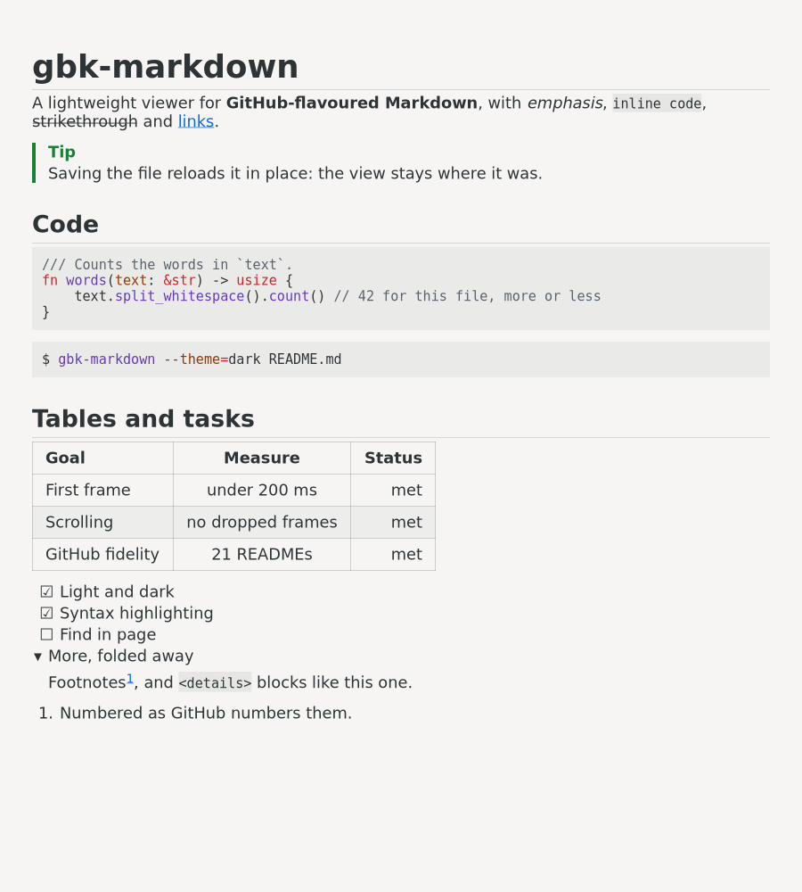
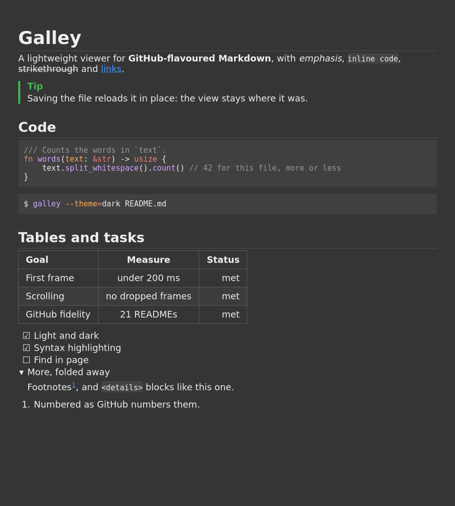

<h1>
  <picture>
    <source media="(prefers-color-scheme: dark)" srcset="docs/logo/galley-dark.svg">
    
  </picture>
</h1>

A lightweight Markdown viewer for the Linux desktop, in Rust and GTK 4. In order of priority, it
aims for:

1. a short time to the first rendered frame,
2. smooth scrolling (no dropped frames, no text laid out while scrolling),
3. faithful GitHub-flavoured Markdown, checked against GitHub's own rendering.

It shows a file the way GitHub shows a README:

- tables, task lists, footnotes, alerts, `<details>` and math;
- emoji shortcodes and heading anchors;
- images, local and remote;
- syntax-highlighted code in GitHub's colours, light or dark.

It reloads the file when it changes.

Developed and tested on Xubuntu 26.04 (X11, GTK 4.22).

| Light | Dark |
|---|---|
|  |  |

The same file ([docs/screenshots/demo.md](docs/screenshots/demo.md)) in both themes, taken by
`scripts/screenshots`.

## Install

```sh
curl -fsSL https://raw.githubusercontent.com/odclcslkrpb5k/galley/main/install.sh | bash
```

This installs the latest release into `~/.local` and needs no root. It copies three files, and
run again it updates them:

- `~/.local/bin/galley`
- `~/.local/share/applications/galley.desktop`
- `~/.local/share/icons/hicolor/scalable/apps/io.github.odclcslkrpb5k.Galley.svg`

To make it the default for Markdown files:

```sh
xdg-mime default galley.desktop text/markdown text/x-markdown
```

The installer takes these options as environment variables before `bash`, for example
`curl … | GBK_VERSION=<hash> bash`:

| Variable | Effect |
| --- | --- |
| `GBK_VERSION=<hash>` | Install a specific release (they are named by commit) instead of the latest. |
| `GBK_PREFIX=<dir>` | Install under `<dir>` instead of `~/.local`. |
| `GBK_ANY_OS=1` | Skip the Ubuntu 26.04 check (see below). |

To uninstall, remove those three files.

**Supported systems.** Release binaries are built on **Ubuntu 26.04, x86_64**, against its GTK
4.22. The installer refuses other systems rather than leave you a program that won't start.
On anything else, [build from source](#building).

## Building

The build runs in a container, so the host needs only Docker and Git:

```sh
scripts/check                     # the full gate: lints, tests, licences, a smoke run under Xvfb
scripts/in-docker cargo build --release --locked
```

The binary is `target/docker/release/galley`. Building outside the container needs Rust
1.99 and the GTK 4 development files (`libgtk-4-dev` on Debian and Ubuntu).

From a checkout, the build can be installed the same way:

```sh
scripts/install                   # to ~/.local, and the default application for Markdown
scripts/install --no-default      # to ~/.local only
scripts/install --uninstall       # removes it, and gives Markdown back to what had it before
```

Releases are published with `scripts/publish` (maintainer). It refuses anything but the
gate's build of a pushed commit.

## Using

```sh
galley README.md
galley --anchor=installation README.md
galley
```

With no file (as from the applications menu), the window shows the logo and waits: drop a
Markdown file on it, or press Ctrl+O. Dropping a file on any window opens it there; drop
several and the rest open in windows of their own.

`galley --help` lists the options and keys:

| Keys | Action |
|---|---|
| arrows, Page Up/Down, Space, Home/End | scroll |
| Ctrl + plus/minus/0 | text size |
| Ctrl+R or F5 | reload |
| Alt+Left or Backspace, the mouse's back button | go back after following a link |
| Alt+Right, the mouse's forward button | go forward again |
| Ctrl+O | open another file in the window |
| Ctrl+E | open the file in your text editor |

`--theme=light|dark` overrides the desktop's choice. `--offline` fetches no remote images.

## How it is checked

`docs/plan.md` is the design, with what was built and why. `docs/perf-baseline.md` holds the
measurements, and `docs/claude-notes.md` the decisions and their history. The gate
(`scripts/check`) runs every check before any push, with the code held to strict lints (plan
§7). The checks include:

- tests against the CommonMark/GFM specification and against 21 READMEs as GitHub renders them;
- mutation testing of the logic;
- licence checks of every dependency and of the grammars shipped.

## Licence

Galley is under the MIT licence: see [LICENSE](LICENSE).

Material from others keeps its own licence:

- **Test data** in `crates/core/tests/data/` (not part of the program):
  - The CommonMark/GFM specification files in `spec/` are under CC-BY-SA 4.0. Their notice is
    in `spec/COPYING-cmark-gfm`.
  - Each README in `corpus/` keeps its project's licence: MIT, Apache-2.0, BSD-3-Clause,
    Unlicense or CC0. The licence is in the README's directory, with the project's NOTICE where
    it has one, and the source and commit are in `SOURCE.toml`.
- **Dependencies:** all crates are under permissive licences, checked by `cargo-deny`
  (`deny.toml`).
- **Syntax grammars:** the code-highlighting grammars come from
  [bat](https://github.com/sharkdp/bat) through the
  [two-face](https://codeberg.org/CosmicHarper/two-face) crate. Each is under its own
  permissive licence, listed in two-face's
  [acknowledgements](https://codeberg.org/CosmicHarper/two-face/src/tag/v0.5.2+bat-0.26.1/generated/acknowledgements_full.md).
  The program leaves out 20 grammars whose licences do not allow shipping them here: one
  package is GPL-3.0, seven have no licence (at the version bat ships). They are listed in
  [`crates/app/grammars-excluded.txt`](crates/app/grammars-excluded.txt), and the gate checks
  the binary contains none of them.

The notices of everything built into the binary, crates and grammars, are in
[THIRD-PARTY-NOTICES.md](THIRD-PARTY-NOTICES.md). Releases include that file, and
`galley --licenses` prints it. It is generated by `scripts/third-party`, and the gate
checks it is current.
