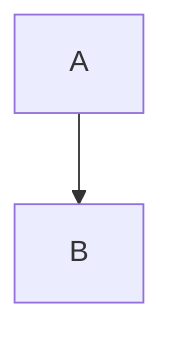

# Feature coverage

Synthetic input covering GFM features that real READMEs rarely use together.

## Alerts

> [!NOTE]
> Useful information.

> [!TIP]
> Helpful advice.

> [!IMPORTANT]
> Key information.

> [!WARNING]
> Urgent info.

> [!CAUTION]
> Negative outcomes.

> [!NOTE] A custom title
> Does GitHub treat this as an alert or a plain quote?

> [!note]
> Lower-case marker.

## Footnotes

Here is a footnote reference[^1], another[^long], and a repeat[^1].

[^1]: The first footnote.
[^long]: A longer footnote with a second paragraph.

    Indented continuation paragraph.

## Math

Inline math $a_b_c + \sqrt{x}$ and code-style math $`e^{i\pi} = -1`$.

$$
\int_0^1 x^2 \, dx = \frac{1}{3}
$$

```math
E = mc^2
```

## Task lists

- [x] done
- [ ] not done
  - [x] nested done
  - [ ] nested open
- plain item

1. [ ] ordered task
2. [x] ordered done

## Tables

| Left | Centre | Right | Default |
|:-----|:------:|------:|---------|
| a | b | c | d |
| `code` | **bold** | ~~strike~~ | [link](https://example.com) |
| pipe \| escaped | | trailing | x |

## Inline formatting

*emphasis*, **strong**, ***both***, ~~strikethrough~~, ~single tilde~, `code`,
<kbd>Ctrl</kbd>+<kbd>C</kbd>, H<sub>2</sub>O, x<sup>2</sup>, <b>b tag</b>, <i>i tag</i>,
<del>del tag</del>, <s>s tag</s>, <ins>ins tag</ins>, <mark>mark tag</mark>.

Hard break with two spaces  
and with a backslash\
and a soft break
here.

## Autolinks

https://example.com, www.example.com, user@example.com, <https://example.org/path?q=1>.

## Raw HTML

<p align="center">
  
</p>

<div align="right">Right-aligned div text.</div>

<!-- an HTML comment that should not be visible -->

<details>
<summary>Click to expand</summary>

Hidden **Markdown** content.

- list inside details

</details>

<picture>
  <source media="(prefers-color-scheme: dark)" srcset="https://example.com/dark.png">
  
</picture>

<script>alert("should not run")</script>
<style>p { color: red }</style>

Inline <span style="color:red">span with style</span> and <unknowntag>unknown tag text</unknowntag>.

<br>

<hr>

## Emoji

:smile: :rocket: :+1: :octocat: :not_a_real_shortcode:

## Headings and anchors

### Duplicate

### Duplicate

### Héading with ünïcode & punctuation!?

### `code` in heading

Setext heading
--------------

Link to [the duplicate](#duplicate-1) and [the unicode one](#héading-with-ünïcode--punctuation).

## Lists

- tight
- list

- loose

- list

3. starts at three
4. four

* nested
  1. ordered inside
     - bullet inside
       > quote inside list
       ```rust
       fn code_inside() {}
       ```

## Code

```rust
fn main() {
    println!("hello");
}
```



    indented code block

## Links and images

[relative doc](docs/other.md#section), [reference link][ref], [absolute](/docs/root.md).

 and a badge link [](https://example.com).

[ref]: https://example.com/ref "Reference title"

## Mentions and references

@octocat #123 a1b2c3d4e5f6a7b8c9d0e1f2a3b4c5d6e7f8a9b0

---

The end.
